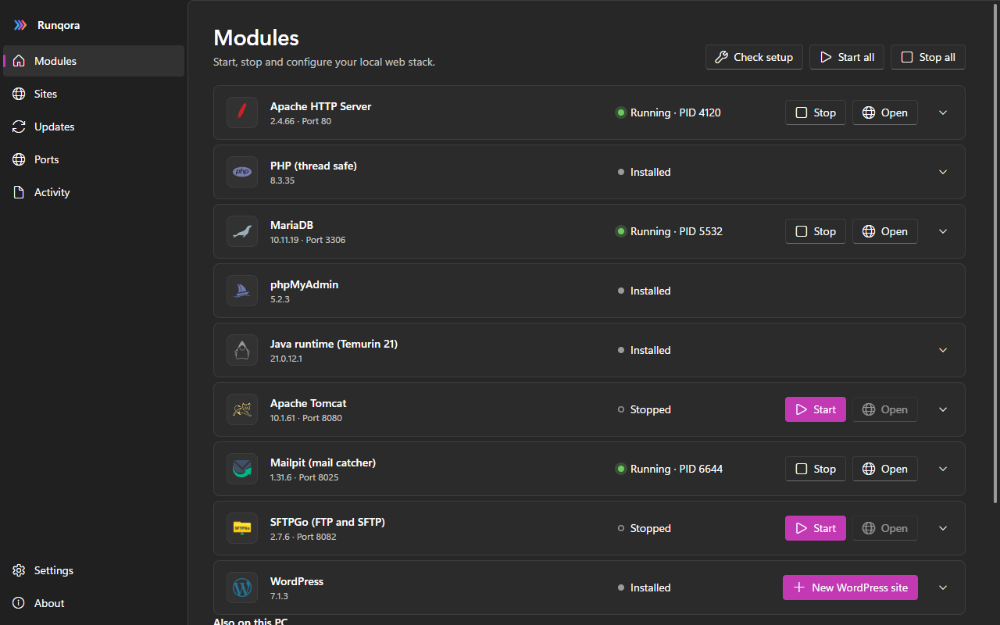
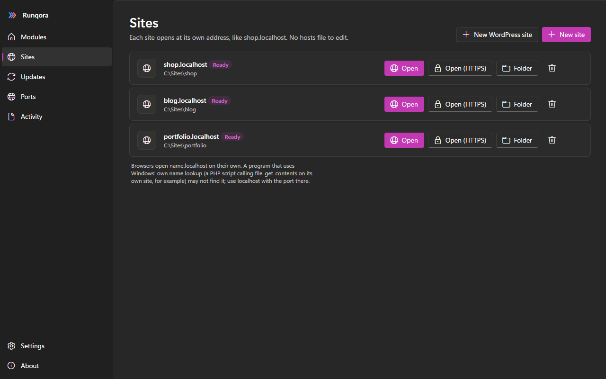
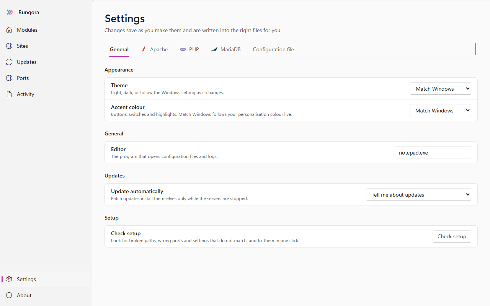

  

<h1 align="center">Runqora</h1>

  A local web stack for Windows: Apache, PHP, MariaDB and more, installed, run and updated from one clean window.

  <a href="https://github.com/ShoaibAhmedSoomro/runqora/releases/latest/download/Runqora-Setup-x64.exe"><b>Download for Windows</b></a>
  &nbsp;·&nbsp;
  <a href="https://shoaibahmedsoomro.github.io/runqora/">Website</a>

  

## Features

**Stack**
- Installs Apache, PHP, MariaDB and phpMyAdmin, each checked against the publisher's checksum before it is unpacked
- Also available: Apache Tomcat (with its Java runtime), Mailpit mail catcher, SFTPGo (FTP and SFTP), WordPress, Node.js, Composer and Adminer
- **Open** on any module starts what it needs first: Open on phpMyAdmin starts MariaDB and Apache if they are stopped, then opens the page (`rq open phpmyadmin` does the same)
- Folder buttons: one for the whole install and one on every module (also in the tray menu, and `rq folder`)
- Start, stop and restart each server, start everything in the right order, or start chosen servers when Runqora opens
- Optional Windows service for Apache and MariaDB
- Runs FileZilla Server and Mercury Mail when they are already installed on your PC

**Sites**
- Give any folder its own address such as `shop.localhost`, no hosts-file editing
- One-click WordPress site: copies the files, creates the database and writes `wp-config.php`
- Local HTTPS with a private certificate authority; trusting it is a button you press, never automatic

**Settings, not config files**
- PHP limits, time zone and extensions, MariaDB tuning, Apache port and website folder, all as forms
- Export every setting to a `runqora.ini` and import it back with a preview of what will change
- Raw config files and logs are one click away when you want them

**Ports and fixes**
- See every listening port with the program that owns it
- A blocked server offers to end the program, stop the Windows service, or move to a free port
- Check setup finds broken paths, wrong ports and duplicate extensions and repairs them

**Updates**
- Checking everything is on by default: every module and Runqora itself, once a day, with live progress (bytes downloaded, then unpacking, installing and checking) on the card that is updating
- Every module is checked against its own publisher (Apache, PHP, MariaDB, phpMyAdmin, Java, Tomcat, Mailpit, SFTPGo, WordPress, Node.js, Composer, Adminer); patch updates install themselves while servers are stopped, and a failed check puts the old version back
- Runqora updates itself: publish a new release on GitHub and every installed copy shows it on the Updates page within minutes, with the release notes and a checked download
- Minor and major upgrades show their warnings first, keep the old version, and can be rolled back

**Windows 11 look and feel**
- Fluent design with Mica, light and dark themes that follow Windows, and an accent colour that follows yours
- Responsive layout that fills the window at any size
- Lives in the system tray like XAMPP's control panel: closing the window keeps Runqora running, and the tray menu has a submenu per server (status dot, Start/Stop, Open, Settings, config files and logs), Start all, Stop all and Quit
- Updating Runqora installs over the old version in place (nothing is uninstalled first; your settings, servers and databases are untouched)
- Start with Windows: the installer asks once, and it is a switch in Settings and a tick in the tray menu. It opens hidden in the tray; a second launch just brings the running copy forward
- A full command line, `rq`, for everything the window does

  
  

## Developer

[GitHub](https://github.com/ShoaibAhmedSoomro) · [LinkedIn](https://www.linkedin.com/in/shoaibaofficial/) · [Instagram](https://www.instagram.com/shoaib_ahmedsoomro) · [Facebook](https://www.facebook.com/shoaibahmedsoomroofficial/)

Released under the [MIT license](LICENSE). Apache, PHP, MariaDB, phpMyAdmin, Tomcat, WordPress and the other programs Runqora installs belong to their projects; Runqora is not affiliated with them.
